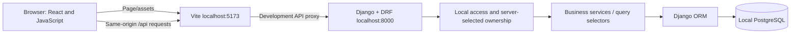

# Proposed architecture

Status: local onboarding, income, expenses/categories and a monthly overview are implemented. Main navigation now opens Overview by default for saved profiles, with Income, Expenses and Profile. Savings goals and other modules remain planned. Registration/login are explicitly deferred. Review alongside [database](DATABASE.md), [scope](FEATURES.md), and [decisions](DECISIONS.md).

## Current single-user mode

`config.settings.local` enables `LOCAL_SINGLE_USER`; base settings disable it. Profile, money, overview and CSRF endpoints share a guard accepting only loopback clients and local hostnames through the Vite same-origin proxy. Never enable this mode on a public server. CSRF middleware and explicit protection remain on anonymous writes; no global DRF permission defaults were relaxed.

The server selects the reserved `_savequest_local` owner, created only on first profile save with an unusable password. An existing usable/staff/superuser account with that name produces a conflict instead of being taken over. GET does not create records. Profile PUT updates one OneToOne record inside a transaction and locks its owner, so retries do not create extra profiles. Income requires a completed profile and uses that same server-selected owner; no owner ID is accepted from the client. Multi-user authentication requires a separately approved transition, not simply exposing these local endpoints.

Current API: `GET /api/v1/health/`, `GET /api/v1/csrf/`, `GET/PUT /api/v1/profile/`. GET returns `{profile: null}` before onboarding. The CSRF endpoint returns a masked token and cookie; the frontend sends it in `X-CSRFToken` for PUT. Missing/invalid CSRF fails even without login. Profile responses are never cached. Existing savings is stored as a nullable estimate, not a balance or ledger movement.

Income API: `GET/POST /api/v1/income/` and `GET/PUT/DELETE /api/v1/income/{id}/`. Lists accept `month=YYYY-MM&page=1`, default to the configured local month, and return `results`, decimal-string `total`, `count`, `page`, `pages`, and `month`. Pages hold 25 records; totals aggregate all non-deleted entries for the month. Future received dates and nonpositive/invalid amounts are rejected. List/detail reads are never cached.

Create requests carry a UUID `request_key`, unique per owner. Under an owner row lock, same-key/same-payload retries return the existing entry; changed payloads or deleted entries return 409. PUT/DELETE require `expected_version` and lock the entry; stale writes return 409. Deletes set a timestamp instead of removing the row. Each mutation writes an audit snapshot in the same transaction. The React API client shares CSRF/error/timeout handling across onboarding and income, while income forms retain their creation UUID on retries.

Expense API follows the same mutation/retry/audit pattern at `GET/POST /api/v1/expenses/` and `GET/PUT/DELETE /api/v1/expenses/{id}/`. Expense lists return decimal-string total, essential and optional totals, pagination and category breakdowns for the whole month. Each expense belongs to the local owner and one of that owner's categories; future dates and nonpositive amounts are rejected. `is_essential` is explicitly saved per entry so category-default changes do not rewrite history.

Categories: `GET/POST /api/v1/expense-categories/`, `PUT /api/v1/expense-categories/{id}/`. Names are normalized and unique per owner; updates require a version. Default categories are added by migration for existing profiles and inside first onboarding save for new profiles. Profile edits do not recreate renamed defaults. Archive/restore preserves all expense history. New entries require active categories; an edit may retain its existing archived category.

`GET /api/v1/overview/?month=YYYY-MM` computes recorded income, expenses, essential/optional spending, category totals and `remaining = income - expenses` in the backend. All values exclude deleted records and profile estimates. Remaining may be negative, excludes savings transfers, and is never labelled a bank balance. This is a basic overview, not the future savings/XP dashboard.

## System shape

A single Django service and one React application form a small monorepo. PostgreSQL is the only persistent service. Start with ordinary synchronous HTTP and database transactions; no workers or event infrastructure are needed.



The development proxy keeps browser requests same-origin, avoiding a CORS package. Use `localhost` consistently; do not mix it with `127.0.0.1`. Django trusts exactly `http://localhost:5173` for development CSRF checks and accepts only explicitly configured local hosts. The backend binds to loopback. Vite uses a fixed port with strict-port behavior so it cannot silently move to an untrusted origin. A future deployment should serve frontend and API under one HTTPS origin after a separate review.

## Proposed version families and reasons

Checked against official guidance on 6 November 2026. The first laptop already has Python 3.14 and PostgreSQL 18; these supported versions are reused. Exact dependency pins are stored in the lockfiles. Live connectivity and profile/income persistence checks pass; separate test-role credentials remain unconfigured.

| Tool | Recommendation | Reason |
| --- | --- | --- |
| Python | Python 3.14, maintained patch | Existing installation; supported by Django 5.2.8 and later |
| Django | Latest security patch of 5.2 LTS | Long-lived stable baseline; extended support through April 2028 |
| Django REST Framework | Current stable release explicitly supporting Django 5.2 and Python 3.14 | Serializers, validation, permissions, and conventional REST endpoints |
| PostgreSQL | 18, latest minor patch | Existing running installation; both developers should use the same major version |
| PostgreSQL driver | Compatible Psycopg 3 stable release, Windows binary distribution locally | Avoid a local compiler setup; use Django's supported driver |
| Node.js | Latest Node 24 LTS patch | Conservative supported runtime meeting Vite's documented requirement |
| React / React DOM | Matching stable 19.x versions | Function components, hooks, straightforward JavaScript |
| Vite | Current stable release compatible with Node 24 and React plugin | Local dev server and production builds without a framework layer |
| Charts | Compatible stable Recharts release | Requested charting library; pin after checking React peer requirements |
| Tests | Compatible Vitest, jsdom, React Testing Library; Django test runner | Focus on user behavior and financial correctness |
| Styling | Custom CSS and system fonts | No template cost, remote font dependency, or styling framework needed |

Use `fetch` for HTTP and React state/context only for session and shared UI state. Recommend React Router for navigation during frontend setup; record its exact compatible version then. Use Python's standard `zoneinfo`, Django's password hashing, and Django's built-in pagination tools through DRF. Use a small `.env` loader (`python-dotenv`) rather than custom parsing. No paid tooling is required.

Official references: [Django support](https://www.djangoproject.com/download/), [Django 5.2 compatibility](https://docs.djangoproject.com/en/5.2/releases/5.2/), [DRF requirements](https://www.django-rest-framework.org/), [Django PostgreSQL support](https://docs.djangoproject.com/en/5.2/ref/databases/#postgresql-notes), [PostgreSQL support policy](https://www.postgresql.org/support/versioning/), [Node release policy](https://nodejs.org/en/about/previous-releases), [Vite prerequisites](https://vite.dev/guide/), [React versions](https://react.dev/versions).

Python direct/transitive pins are in `backend/requirements.lock.txt`, direct requirements in `backend/requirements.in`, and npm pins in `frontend/package-lock.json` and `package.json`. Installed: Django 5.2.19, DRF 3.18.3, Psycopg 3.3.8, React/React DOM 19.3.1, Vite 8.3.6, React plugin 6.2.1, Vitest 5.1.0, and jsdom 26.1.0. jsdom is pinned to a version compatible with the installed Node 24.12.0; its newest release requires a newer Node patch. Recharts and React Router are deferred until their first use. Both developers use the same runtime families; dependency updates use reviewed PRs.

## Django application boundaries

Start with four apps, not one app per entity:

| App | Responsibilities |
| --- | --- |
| `accounts` | Custom User, local profile, CSRF and onboarding; session endpoints deferred |
| `finances` | Income, expenses, spending categories, month filtering, summaries |
| `savings` | Savings categories, goals, ledger, allocations, emergency planning, dashboard aggregation |
| `gamification` | Basic badges first; later XP events, challenges, education completion |

`AUTH_USER_MODEL` was set before the first migration. No username/password screens are implemented; the local account cannot log in by password. The schema retains Django ownership relationships for future expansion. Education can begin as reviewed versioned content and completion records under `gamification`; split an `education` app only when content management warrants it.

Within each app use models, serializers, views, URLs, services for writes, selectors for reads, and tests. Avoid repositories over the ORM, generic enterprise abstractions, and hidden signals for financial/reward behavior. Services explicitly call award functions in the same transaction.

## API shape

All application endpoints are under `/api/v1/`. The current profile and CSRF APIs are described above. The table below is the future multi-user/API design; session routes and PATCH/onboarding-specific routes are not implemented.

| Area | Proposed endpoints |
| --- | --- |
| Connectivity | `GET health/` with database readiness and no secrets |
| Session | `GET auth/csrf/`, `POST auth/register/`, `POST auth/login/`, `POST auth/logout/`, `GET auth/me/` |
| Profile | `GET/PATCH profile/`, `POST profile/onboarding/` |
| Money | `income/`, `expenses/`, `expense-categories/` with normal CRUD and filters |
| Savings | `savings/categories/`, `goals/`, `goals/{id}/transactions/` |
| Corrections | `POST savings/transactions/{id}/correct/` or `reverse/` with an idempotency key |
| Plans | `allocations/?month=YYYY-MM`, emergency target preview/update |
| Overview | `GET dashboard/?month=YYYY-MM`, `GET achievements/` |
| Later | Simulator preview, lessons, lesson completion, challenges and XP history |

Use decimal strings in JSON (for example `"1250.50"`), ISO dates, and explicit currency metadata. Month filters are half-open date intervals. Lists use pagination (initial page size 25, maximum 100), allowlisted ordering, and indexed ownership/date filters. Errors have stable codes, field messages and a general message; frontend handles 400, 403, 404, 409 and server failures distinctly. DRF session authentication may return 403 for unauthenticated requests; session state is resolved through `auth/me/`, not assumptions about every failure being 401.

The server supplies owner fields. In current local mode it selects the reserved local owner; in a future multi-user mode querysets must filter to the authenticated user. Every future goal/category relationship must match that owner. Avoid raw exceptions or personal financial details in logs.

## Deferred multi-user session design

This section is a future design, not the current workflow. Registration and login are deferred by the owner. Current local CSRF behavior is described above.

1. Browser requests `auth/csrf/` through Vite. Django sets the CSRF cookie; endpoint returns a masked token for the frontend to keep in memory.
2. Registration and login explicitly require CSRF even for anonymous users. Use CSRF-protected Django views or equivalent explicit enforcement; DRF SessionAuthentication alone does not protect anonymous login requests.
3. Send cookies with same-origin fetch and `X-CSRFToken` on unsafe requests. Validate passwords through Django, login through Django, rotate sessions normally, and refresh the CSRF token after login.
4. Session cookies are HttpOnly and SameSite=Lax. Use Secure cookies under HTTPS. Plain HTTP loopback development requires Secure=False in development settings only. Never disable CSRF to fix connectivity.
5. Logout is CSRF-protected POST and destroys the session. React clears its in-memory user and token state.
6. Use Django authentication and permission defaults; only health, CSRF, registration and login are public. Establish a local login attempt rate limit during auth work; public abuse controls and password recovery require a separate launch design.

See [Django CSRF](https://docs.djangoproject.com/en/5.2/howto/csrf/) and [DRF session authentication caveat](https://www.django-rest-framework.org/api-guide/authentication/#sessionauthentication).

## Proposed project folders

The following is the target layout, introduced incrementally. Accounts/profile and finances income/expense/category models, migrations, services, serializers, views and tests exist. React has onboarding, profile, income, expense/category management and overview components plus shared API/formatting helpers. Goals, savings ledger, richer dashboard, authentication and demo seed commands are not implemented:

```text
SaveQuest/
  AGENTS.md
  README.md
  .gitignore
  docs/
    ARCHITECTURE.md  DATABASE.md  FEATURES.md  UI_UX.md
    GAMIFICATION.md  ROADMAP.md  DEVELOPMENT.md  DECISIONS.md
  backend/
    .env.example
    requirements.in
    requirements.lock.txt
    manage.py
    config/
      settings/{base,local,test}.py
      urls.py  wsgi.py  asgi.py
    accounts/
    finances/
    savings/
      management/commands/seed_demo.py
    gamification/
    # Every app: migrations/, tests/, models.py, serializers.py,
    # views.py, urls.py, services.py, selectors.py as needed
  frontend/
    .env.example
    package.json
    package-lock.json
    vite.config.js
    src/
      app/            # routes, providers, app shell
      api/            # client, session and resource requests
      components/     # shared accessible UI
      features/       # domain pages, forms, hooks and tests
      styles/         # tokens, layout, components
      test/           # test setup
```

No stored total balances or XP counters are necessary at MVP scale. Aggregate indexed records in backend selectors. Optimize only with measured evidence and reconciliation tests.
