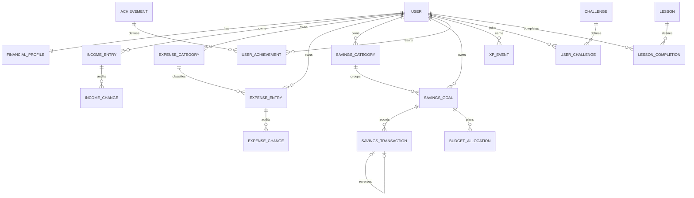

# Proposed PostgreSQL design

Status: User, profile, income/expense entries, expense categories and private income/expense audits are implemented and migrated. Savings ledger and remaining entities below are planned. All authoritative money uses `DecimalField(max_digits=14, decimal_places=2)`, never floating point. API money is serialized as strings. Values must be finite, within precision, and have at most two decimal places; do not silently round user input.

IncomeEntry also stores `request_key` UUID, creation payload fingerprint, integer version, created/updated timestamps and nullable `deleted_at`. Constraints enforce positive amounts, version >= 1, and unique `(user, request_key)`; `(user, received_on)` is indexed. Lists/totals exclude deleted entries. Future-dated actual income is rejected in both serializer and model validation. An IncomeChange belongs to an entry and records action, timestamp, and before/after JSON audit snapshots with monetary values represented as strings. Authoritative amounts remain Decimal columns on IncomeEntry. Audit snapshots and soft-deleted entries are private historical data, not extra income records.

ExpenseEntry uses the same retry/version/tombstone/audit pattern with `spent_on`, `category` and an explicit `is_essential` snapshot. ExpenseChange contains immutable before/after snapshots; it never contributes to totals. PostgreSQL checks enforce positive expense amounts/versions and unique owner/request UUIDs; `(user, spent_on)` is indexed. Model and service validation require matching category/entry ownership. Category defaults only suggest a type for new entries and cannot change old classification.

ExpenseCategory has unique `(user, normalized_name)`, display name, default-essential flag, archive flag and version. The defaults migration inserts missing categories for existing profiles without changing any financial record. New profile creation supplies the same defaults atomically; ordinary profile edits leave renamed/archived categories alone. Referenced categories are archived/restored rather than deleted. Existing expenses can retain an archived category, but new entries or category changes must use active categories.

Current single-user owner: server-selected `_savequest_local`, unusable password, no registration/login. The profile stores nickname (60 chars), income type, nullable monthly income/essential-expense/existing-savings estimates, priority, goal ideas (500 chars), completion timestamp and audit timestamps. Three database constraints reject negative estimates. Missing estimates differ from zero. Currency/timezone remain INR/Asia-Kolkata configuration rather than editable fields in this milestone. Goal ideas are plain text, not SavingsGoal records.

## ER diagram



Challenges, XP and lessons are Phase 4 tables, shown to validate extensibility. Income recurrence templates and monthly streak evaluation history are also deferred.

## MVP entity fields

All entities have a primary key. Mutable entities have `created_at` and `updated_at`; ledger and reward events have immutable `created_at`. Use timezone-aware timestamps stored in UTC and `DateField` for user-entered financial dates. Profile timezone determines the current month; do not derive financial dates by converting UTC timestamps.

| Entity | Principal fields and relationships | Constraints / behavior |
| --- | --- | --- |
| User | Django AbstractUser subclass; username, password hash, optional email | Username unique; no bank details; custom model before initial migration |
| UserFinancialProfile | OneToOne User; nickname, income_type, expected_monthly_income nullable, essential_monthly_expenses nullable, currency, timezone, priority, onboarding_completed_at | Estimates >= 0; MVP currency INR; estimates never count as actual income or expenses; priority is a small choice field |
| IncomeEntry | User FK, amount, source choice, optional label, received_on, note, request key/fingerprint, version, deletion timestamp | Implemented; amount > 0; actual dates cannot be future; sources salary/freelance/allowance/other; owner-scoped retries and versioned mutations |
| IncomeChange | IncomeEntry FK, action, before/after snapshots, timestamp | Implemented; created in same transaction as entry mutation; never included in totals |
| ExpenseCategory | User FK, name, normalized_name, default_essential, is_archived, version | Implemented; unique `(user, normalized_name)`; owner-specific defaults; versioned archive/restore |
| ExpenseEntry | User FK, category FK, amount, spent_on, is_essential, label, note, request key/fingerprint, version, deletion timestamp | Implemented; amount > 0; own category only; essential flag independent of category default changes |
| ExpenseChange | ExpenseEntry FK, action, before/after snapshots, timestamp | Implemented; atomic private audit history; not an extra financial movement |
| SavingsCategory | User FK, name, normalized_name, kind, is_archived | Unique name per user; kinds emergency/security/travel/entertainment/short_term/long_term/custom |
| SavingsGoal | User FK, SavingsCategory FK, name, target_amount nullable, target_date nullable, is_reserve, is_archived, emergency_months nullable | Named goals require target > 0; target-less reserve pockets allowed; target date optional; at most one emergency goal per user |
| SavingsTransaction | Goal FK, signed amount, kind, occurred_on, idempotency_key, reverses OneToOne self nullable, correction_reason | Kinds opening/contribution/withdrawal/reversal; immutable; amount nonzero; see ledger rules below |
| BudgetAllocation | Goal FK, month (first day), planned_amount | Unique `(goal, month)`; amount >= 0; check first-of-month; category and user derived from goal |
| Achievement | code unique, name, description, rule_version, active | System catalog seeded idempotently; no arbitrary executable rule text |
| UserAchievement | User FK, Achievement FK, awarded_at, evidence reference | Unique `(user, achievement)`; immutable earned badge history |

Default savings categories each have a reserve goal/pocket if users want category savings without a named purchase. Category balances aggregate all their goals. Transactions have one required goal FK; ownership and category are derived. There is no second category-level contribution table and no optional goal/category ambiguity.

`existing_savings_estimate` remains an editable planning estimate, never an authoritative balance or income entry. No savings ledger exists yet. When the ledger milestone is implemented, explicitly confirm the estimate and convert it once into `opening` entries allocated to selected pockets; an unallocated remainder can use a starting-savings reserve. Record a conversion marker and make retries atomic/idempotent. Never add the estimate to ledger or income totals or reconvert it after profile edits. Actual balance corrections belong to the ledger, not this estimate.

Monthly contribution plans live only in BudgetAllocation. A goal's displayed monthly plan reads that month's allocation; category plans sum goal allocations. Avoid a second editable monthly-plan field on SavingsGoal. A desired pace to reach a deadline is a computed suggestion, not an allocation or actual contribution.

## Later entities

| Entity | Fields and important rules |
| --- | --- |
| XPEvent | User, points positive integer, rule_code, source_key, rule_version, created_at; unique `(user, rule_code, source_key)`; server-generated evidence keys |
| Challenge | Unique code, title, explanation, rule_code/version, optional duration, active; vetted definitions |
| UserChallenge | User, Challenge, start/end date, frozen affordable target, status, completed_at; one active enrollment per challenge/user via conditional uniqueness; one completion reward per enrollment |
| Lesson | Unique slug, content_version, title, reviewed content/quiz definition; initially stored/seeded from repository content |
| LessonCompletion | User, Lesson, completed_at, passed version; unique user/lesson for one-time XP; quizzes evaluated server-side |

Meaningful multi-value priorities can later use a join table; avoid JSON blobs for relational money data. Recurrence templates will describe expected entries separately and require confirmation before creating actual entries.

## Ownership, indexes and deletion

- Every direct user FK is indexed; add composite indexes on `(user, received_on)`, `(user, spent_on)`, `(goal, occurred_on, id)` and `(user, created_at)` on XP. Goal/category ownership lookups and allocation uniqueness get indexes from their constraints.
- Use DB checks for amount signs, positive targets, nonnegative estimates/plans, valid emergency months (proposed 1–12), reversal self-reference exclusion, and supported kinds. Unique reversal links and idempotency keys are database enforced.
- Ownership across two related tables cannot be expressed as an ordinary Django CheckConstraint. Serializers and all write services independently enforce it, including admin/seed paths. Do not expose unrestricted financial model editing in admin.
- Transaction ownership derives from the immutable goal owner. Never allow ownership reassignment. Lock goal/category changes after ledger history exists; otherwise balances would silently move between categories.
- Protect referenced categories and goals from deletion. Archive them; hide from new-entry pickers but retain history. Savings transaction updates/deletes are forbidden; corrections are explicit ledger operations. Remove unused goals/categories only when no history exists.
- Income and expense edits/confirmed deletes use version checks and immutable before/after audits. Deleted entries remain as tombstones, disappear from reads/totals, and cannot be recreated by replaying the same request key. All audit data inherits financial privacy protections; do not log values to application logs.
- Account deletion and backups need a separate explicit policy before public launch. No automatic database reset or cascading removal of users during seeding.

## Financial definitions

These formulas define the product; they are not statements about the user's bank balance.

For a month M, using actual entries in M:

```text
income                 = sum(income entries)
expenses               = sum(expense entries)
before_savings_balance = income - expenses
gross_contributions    = sum(positive ordinary contributions, after corrections)
withdrawals            = sum(absolute ordinary withdrawals, after corrections)
net_recorded_savings   = gross_contributions - withdrawals
recorded_remainder     = income - expenses - net_recorded_savings
planned_savings        = sum(month's BudgetAllocation amounts)
savings_rate           = net_recorded_savings / income * 100, if income > 0
```

Show both gross contributions and withdrawals in detail. Opening balances are excluded from monthly savings flows, income, and rewards. Reversals cancel their original flow classification on the original financial date; they are not new savings. Net savings may be negative. If income is zero, savings rate is “Not available — no income recorded”; do not divide by zero or invent 0%. It may exceed 100% when saving money received earlier; explain that it is a recorded-flow ratio, not a grade.

Do not call `recorded_remainder` an available bank balance or a verified spendable amount. Savings are internal allocations, not expenses. Spending funded by a savings withdrawal is one withdrawal plus one expense; the withdrawal itself is not income. Category totals and goal totals are views of the same ledger and must never be added together.

For a goal:

```text
balance          = sum(all signed ledger amounts, including openings/reversals)
remaining        = max(target - balance, 0)
progress         = balance / target * 100, if target exists
display_bar      = clamp(progress, 0, 100)
emergency_target = current essential expense estimate * chosen coverage months
```

Allow overfunding and show the actual amount even when the bar stops at 100%. Target-less reserves have no completion percentage. Goal completion is derived from current balance, so a withdrawal can reopen a goal. Earned badges remain; they are not awarded again. Archived goals remain part of total savings.

Emergency settings update the dedicated goal's target through an explicit preview/confirm action. Changing the essentials estimate must not silently rewrite an existing emergency target. Show the basis used for that target. Example: ₹15,000 essentials × 6 months = ₹90,000; this is a user-selected guideline, not a universal requirement.

Suggested allocation capacity = `max(expected income - essential estimate - user-selected optional spending allowance, 0)`. If estimates are missing, request an optional estimate rather than assuming essentials are zero. Spread only the capacity the user chooses; do not enforce a fixed 50/30/20 rule. Actual records may exceed estimates or reflect pre-existing cash; warn and explain without claiming to verify funds.

## Ledger mutation and correction rules

1. Validate ownership, amount, date, goal status, and request idempotency. Enforce ledger kind/sign consistency: opening and contribution positive; withdrawal negative; reversal exactly the negative of its linked original.
2. Within `transaction.atomic`, lock the goal row using `select_for_update`. All services writing that goal's ledger must take the same lock.
3. Opening transactions are explicit starting funds. Normal withdrawals cannot make the goal balance negative. For backdated entries/corrections, also validate the complete resulting running balance on `(occurred_on, id)` so no historical overdraft is introduced. Reject future-dated actual entries.
4. Corrections append a reversal plus, if needed, a replacement, atomically. Never mutate the original. Reversal date matches the original financial date; creation timestamp records when it was corrected. Each original can be reversed once; reversing a reversal is forbidden. Correct the replacement for subsequent changes. Validate the completed correction as a group, so its internal temporary order cannot create false overdrafts.
5. Reject corrections to opening/contribution entries if they would leave a later withdrawal unfunded. Explain the conflict and require correcting the dependent withdrawal first. Preserve all history.
6. Use a globally unique request UUID for each ledger operation, plus a stored request fingerprint and result reference. The same key with the same payload returns the original result; a different payload returns conflict. Correction child entries get deterministic distinct keys. This can be a small operation record added with ledger services; it is not a separate financial movement.
7. Evaluate applicable badges/XP explicitly in the same transaction. Uniqueness constraints handle retries; use a nested savepoint for expected uniqueness races or a safe get-or-create pattern. Do not catch an IntegrityError and continue using a broken outer transaction.

Concurrent withdrawals must be tested against PostgreSQL, not SQLite. The ledger is auditable bookkeeping for manually recorded savings; it is not a banking ledger or a guarantee of actual funds.

## Verification examples

With ₹40,000 income, ₹25,000 expenses, ₹5,000 contribution and ₹1,000 withdrawal, net savings is ₹4,000, rate is 10%, and recorded remainder is ₹11,000. A ₹10,000 opening balance increases goal balance but changes none of those monthly flows.

A single ₹500 contribution to a travel goal increases that goal, its category, and total savings by ₹500 each as different views; global savings increase is ₹500, never ₹1,500. Reversing it removes that ₹500 from its original month's flow. A second identical HTTP request with the same idempotency key creates no new movement or award.
